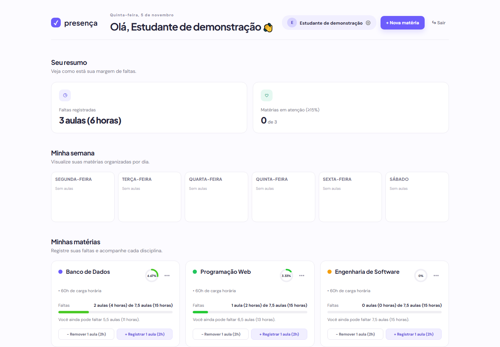

# Sistema de Controle de Faltas



Captura da aplicação local com estudante e disciplinas fictícios.


Projeto simples pra controlar as faltas das matérias da faculdade.

## Como rodar

1. Instale as dependências:
```bash
npm ci
```

2. Rodar o servidor:
```bash
npm start
```

3. Abrir no navegador:
http://localhost:3000

## O que tem aqui

- **Node.js** + **Express** no backend
- **SQLite** para guardar os registros
- HTML, CSS e JS simples no frontend

## Dados e publicação

O banco padrão fica em `database/banco.db`; `DB_PATH` permite escolher outro arquivo. A porta pode ser definida por `PORT`. Preserve o banco ao atualizar o sistema. As instruções de servidor ficam em [DEPLOY_VPS.md](DEPLOY_VPS.md).
